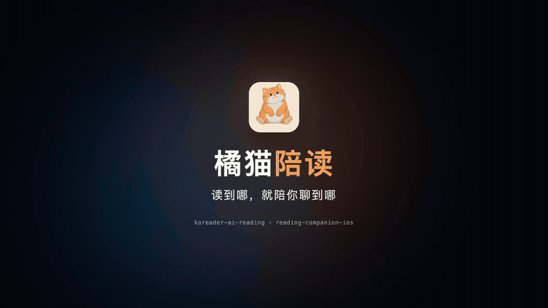

# 橘猫陪读 iOS

[English](README.md) | **简体中文**

橘猫陪读是 iPhone 原生 AI 陪读 App：本地 HTTP 服务接收 Kindle 当前页，Apple Speech 自动 VAD 识别，OpenCode Go 流式回答，Edge TTS 朗读（失败自动回退系统语音）。

> 本仓库只包含 **iPhone App**。
> Kindle / KOReader 侧在 [successcw/koreader-ai-reading](https://github.com/successcw/koreader-ai-reading)。

## 功能

- **点按说话**：点一下麦克风开始，再点一下发送；不再用常开 VAD，避免掐头去尾；
- **停止回答**：橘猫在想或朗读时，点右侧停止按钮，可中断 LLM 流式输出和 TTS；
- **腾讯云一句话识别**：可选，中文准确率更好；没配密钥时回退 Apple Speech；
- **本地 HTTP 桥接**：接收书名、章节、页码、进度、当前页正文；
- **OpenCode Go 流式回答**：`https://opencode.ai/zen/go/v1`，默认 `deepseek-v4.1-flash`；
- **Edge TTS**：逐句合成，第一句会在全文写完前开始播放；
- **AirPods 播放**：识别用手机麦克风，播放走 AirPods；
- **平滑文字输出**：缓冲追加，不逐 token 抖动；
- **橘猫 UI**：自定义 App 图标和背景。

## 宣传视频

<a href="docs/media/promo-zh.mp4"></a>

[观看 45 秒宣传片（MP4）](docs/media/promo-zh.mp4)


## 已验证

| 项目 | 值 |
|---|---|
| iPhone | **iPhone 13 Pro Max** |
| iOS | 27.2 |
| Xcode | 27.0 |
| KOReader | 2026.07.1（Kindle 侧可选） |

要求 iOS 17+。模拟器不需要签名；真机需要 Apple ID/Team。

## 构建运行

```bash
cd reading-companion-ios
xcodegen generate        # 可选，仓库里也有 .xcodeproj
open ReadingCompanion.xcodeproj
```

Xcode 里：

1. Signing & Capabilities 选自己的 Team；
2. 选择 iPhone；
3. Run。

模拟器构建：

```bash
xcodebuild -project ReadingCompanion.xcodeproj \
  -scheme ReadingCompanion \
  -sdk iphonesimulator \
  -destination 'platform=iOS Simulator,name=iPhone 17' \
  CODE_SIGNING_ALLOWED=NO build
```

免费 Apple ID 签名 7 天过期；TestFlight / App Store 需要 $99/年开发者账号。

## App 设置

- **API Key**：OpenCode Go key，存 Keychain；
- **模型**：默认 `deepseek-v4.1-flash`；
- **端口**：默认 `8790`；
- **Token**：默认 `change-me`，必须和 Kindle 插件 `config.lua` 一致；
- **TTS**：Edge 音色选择（晓晓/云希/晓伊/云健/晓北）+ 系统语音回退。
- **腾讯云 ASR**：SecretId / SecretKey / 地域，存 Keychain；留空则用 Apple Speech。需要在腾讯云控制台开通「一句话识别」（每月 5000 次免费）。

Base URL 固定：

```text
https://opencode.ai/zen/go/v1
```

请求 `/chat/completions`，并发送 OpenCode 要求的 `x-opencode-session` 头。

## Kindle 连接

1. iPhone 打开个人热点；
2. Kindle 连接该热点；
3. App 首页显示类似 `http://172.20.10.1:8790/context`；
4. 把这个地址和 Token 填进 KOReader 插件的 `config.lua`。

## 隐私

- App 接收 Kindle 当前页正文，并发给 OpenCode Go 推理；
- 配置腾讯云 ASR 后，录制的语音会发给腾讯云转写；未配置则走 Apple Speech；
- Edge TTS 会把回答文本发给微软 Edge TTS 服务；
- API key 存 Keychain，仓库不包含 key；
- 仓库不包含书、个人图片、账号凭据。

## 已知限制

- App 进入后台后，iOS 可能挂起本地服务；尽量保持前台；
- iPhone 热点不会持续广播，Kindle 需要在广播时连接；
- Edge TTS 是非官方接口，可能变化；失败会回退系统 TTS；
- Apple Speech 准确率受语言包、麦克风距离、噪音影响；
- 腾讯云一句话识别单次最多 60 秒 / 3MB，长句需要分段；
- 目前是原型，不是可直接上架 App Store 的成品。

## 许可证

App 代码 MIT（见 `LICENSE`）。
`Vendor/SwiftEdgeTTS` 为 MIT，见其许可证和 `THIRD_PARTY.md`。
